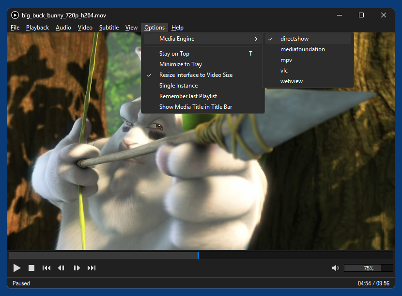

# SMP (SimpleMediaPlayer)



SMP is a simple desktop media player for Windows 11 x64 written in Python. What makes it special is that it supports 5 different multimedia engines (or frameworks) that a user can choose from. Note that changing the active engine requires the current player instance to be restarted.

The application comes initially only with the `webview` and the `mediafoundation` engine (and the `vlc` engine, if a VLC media player is found on the PC), other engines are automatically downloaded (from [here](https://github.com/59de44955ebd/SMP/releases/tag/engines)) when selected for the first time.

The player's UI is (quite obviously) inspired by [MPC-HC](https://github.com/clsid2/mpc-hc), whereas the main menus are closer to the [VLC media player](https://www.videolan.org/).

## Multimedia Engines

### 1. directshow

[DirectShow](https://en.wikipedia.org/wiki/DirectShow) playback is based on [LAV Filters](https://github.com/Nevcairiel/LAVFilters) (which are in turn based on [FFmpeg](https://ffmpeg.org/)) and [MPC Video Renderer](https://github.com/Aleksoid1978/VideoRenderer). Subtitles support is based on [VSFilter](https://github.com/v0lt/VSFilterBE) (DirectVobSub). MIDI files are played with [Bass Audio Source](https://github.com/v0lt/BassAudioSource) and [BASSMIDI](https://www.un4seen.com/doc/#bassmidi/bassmidi.html), which allows to use a SoundFont as soundbank (see [MIDI Support](#midi-support) below).

Filters are loaded directly from .dll and therefor don't need to be registered in the system.

### 2. mediafoundation

This engine uses Microsoft's [Media Foundation](https://learn.microsoft.com/en-us/windows/win32/medfound/microsoft-media-foundation-sdk) for playback, based on a small [wrapper .dll](https://github.com/59de44955ebd/python-mediafoundation/tree/main/dll) that is loaded via ctypes/libffi. It doesn't support subtitles, and the aspect ratio can't be changed (other than turned off).

Since `Media Foundation` can't play MIDI files, an additional minimal DirectShow player that doesn't depend on the DirectShow engine is used to play those.

This engine supports less container formats and codecs than engines `directshow` or `vlc`, but has the benefit of minimum extra file size since `Media Foundation` is provided by the OS.

### 3. mpv

[mpv](https://mpv.io/) playback is based on [libmpv](https://sourceforge.net/projects/mpv-player-windows/files/libmpv/) and its Python binding [python-mpv](https://github.com/jaseg/python-mpv).

Since mpv can't play MIDI files, an additional minimal DirectShow player that doesn't depend on the DirectShow engine is used to play those.

### 4. vlc

[VLC](https://www.videolan.org/) playback is based on [libVLC](https://www.videolan.org/vlc/libvlc.html) and its Python binding [python-vlc](https://github.com/oaubert/python-vlc).

### 5. webview

WebView playback uses [Microsoft Edge WebView2](https://developer.microsoft.com/en-us/microsoft-edge/webview2), which is based on recent Chrome/Chromium versions and comes preinstalled with Windows 11. MIDI support is based on [spessasynth_lib](https://github.com/spessasus/spessasynth_lib).

This engine supports less features, container formats and codecs than the other engines, but has the benefit of minimum extra file size since `WebView2` is provided by the OS.

## MIDI Support

All engines support playing MIDI files (`.mid` `.rmi` `.kar`). All but `mpv` use an external [SoundFont](https://en.wikipedia.org/wiki/SoundFont) file as soundbank. To keep the player's download file size small, only a [small SoundFont](https://musical-artifacts.com/artifacts/5190) (3 MB, based on GM.dls that comes with Windows) is included as file `soundbank.sf2` in the `data` folder. For achieving better MIDI sound quality you can replace this file with a high-quality SoundFont file like e.g. [FluidR3_GM.sf2](https://musical-artifacts.com/artifacts/738) (141 MB) or [Reality_GMGS_falcomod.sf2](https://www.musical-artifacts.com/artifacts/6003) (34 MB). After downloading such a file, just rename it `soundbank.sf2` and put it into `data`.

If you happen to be a MIDI nerd, engine `webview` is the only one that supports the rather exotic but interesting [SF2 RMIDI](https://github.com/spessasus/sf2-rmidi-specification) file format that allows to combine MIDI and soundbank data in a single `.rmi` file.

## Implementation

For each of the 5 available multimedia engines there is a module that implements a class called `Player` with the same public interface:

- [dshow_player.py](src/dshow_player.py)
- [mf_player.py](src/mf_player.py)
- [mpv_player.py](src/mpv_player.py)
- [vlc_player.py](src/vlc_player.py)
- [webview2_player.py](src/webview2_player.py)

The public interface looks like this:
```python
__init__(self, window: object, volume: float = .75)
close_file(self)
get_audio_tracks(self) -> list
get_duration(self) -> float
get_size(self) -> tuple
get_sub_tracks(self) -> list
get_time(self) -> float
get_video_tracks(self) -> list
get_volume(self) -> float
has_audio(self) -> bool
has_video(self) -> bool
hide_subtitles(self, flag: bool = True)
is_fullscreen(self) -> bool
is_midi(self) -> bool
is_playing(self) -> bool
load_media_file(self, media_file: str, on_parsed: callable) -> bool
load_sub_file(self, sub_file: str) -> bool
pause(self)
play(self)
select_audio_track(self, track_id: int)
select_sub_track(self, track_id: int)
select_video_track(self, track_id: int)
set_aspect_ratio(self, ratio: str | None)
set_brightness(self, value: float)
set_contrast(self, value: float)
set_fullscreen(self, flag: bool)
set_loop(self, flag: bool)
set_hue(self, value: float) pass
set_saturation(self, value: float)
set_time(self, secs: float)
set_volume(self, v: float)
skip_back(self, secs: float)
skip_forward(self, secs: float)
step_back(self, frames: int = 1)
step_forward(self, frames: int = 1)
stop(self)
take_snapshot(self, filename: str, callback: callable)
```
